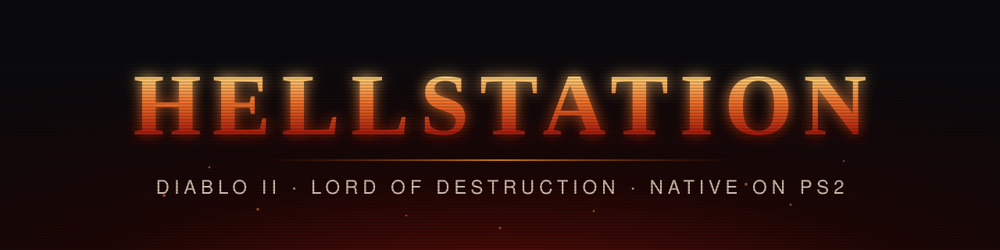

<p align="center">
  
</p>

<p align="center">
  
  
  
  <br>
  <a href="https://github.com/Meanski/HellStation/issues"></a>
  <a href="LICENSE"></a>
  <a href="https://github.com/jaenster/redivivus"></a>
</p>

<p align="center">
  <a href="#status">Status</a> ·
  <a href="#why-it-stopped">Why it stopped</a> ·
  <a href="#build-and-run">Build</a> ·
  <a href="#controls">Controls</a> ·
  <a href="#how-it-works">How it works</a> ·
  <a href="PORTING_LOG.md">Dev log</a>
</p>

---

**Diablo II: Lord of Destruction 1.14d, running natively on PlayStation 2 hardware, as emulated by
PCSX2.** It isn't emulated, streamed or remade: it's the game's own code, compiled for the PS2's
Emotion Engine, with everything a PS2 needs underneath it. That means a fake Windows, a GS
renderer, DualShock 2 input, and a build tuned for the EE.

> [!NOTE]
> **The project has stopped (November 2026).** It plays in PCSX2, but only with PCSX2's Extended
> RAM (128 MB). A retail PS2 has 32 MB, and measuring showed the game can't be made to fit
> without rebuilding large parts of it, while already running below full speed in Act 5. The
> details are below and in the [dev log](PORTING_LOG.md).

## Status

| | Where it ended |
|:-:|-|
| ✅ | Boots to the LoD main menu on an emulated PS2 (PCSX2) |
| ✅ | In game: new character, Rogue Encampment, walking, inventory, at **25 FPS** (the game's own cap) |
| ✅ | Reaches Act 5 (Harrogath, Hell difficulty) with a level 96 character, at **15 FPS** |
| ✅ | DualShock 2 as a virtual mouse plus D2's hotkeys |
| ❌ | A retail PS2's **32 MB**: it needs PCSX2's Extended RAM ([#5](https://github.com/Meanski/HellStation/issues/5)) |
| ⏹️ | Not started: sound, naming a character with the pad, real hardware |

## Why it stopped

A retail PS2 has 32 MB of RAM. After the kernel, the 7.4 MB program and the stack, the game gets
**24.2 MB**. Peak memory on PCSX2, measured with a report built into the port:

| | Rogue Encampment (Act 1) | Harrogath (Act 5, Hell) |
|-|-|-|
| As first measured | 61.1 MB | |
| After every cheap fix | 37.4 MB | 40.3 MB |
| What a retail PS2 has | 24.2 MB | 24.2 MB |

The fixes that got it from 61 to 37 MB:

- **Telling the game it has 32 MB, not 256 MB.** It sizes its caches from what Windows reports.
- **Keeping large and small allocations apart.** The town had been failing to load with 11 MB
  free but cut into pieces too small to use.
- **Thread stacks of 128 KiB, not 1 MiB.** Measured: they never used more than 16 KiB.
- **Capping the sprite cache at 2 MB.** That costs frame rate: sprites get decoded again more
  often.

What's left is the hard part, and it adds up to roughly the gap with nothing to spare:

- the game's pool allocator wastes 3-5 MB in partly empty blocks;
- 7 MB of data tables;
- 3.9 MB of MPQ archive tables.

Sound would add another 3-5 MB, and fights haven't been measured. Meanwhile Act 5 already runs at
15 FPS at full emulated speed, and every memory cut so far has cost speed rather than saved it. The
full measurements and each step are in the [dev log](PORTING_LOG.md) (2026-11-18 entries).

**What would change the answer:** a PS2 with more RAM. Sony's development units had 128 MB,
which is the configuration PCSX2's Extended RAM imitates.

## You bring the game

> [!IMPORTANT]
> This repository holds no game data and never will. You need your own Diablo II and Lord of
> Destruction, patched to 1.14d, and a BIOS dumped from your own PS2.

Put these files in a folder (default `~/d2data`, or point `$D2DATA` at it):

```
d2char.mpq  d2data.mpq  d2exp.mpq  d2music.mpq  d2sfx.mpq  d2speech.mpq
d2video.mpq  d2xmusic.mpq  d2xtalk.mpq  d2xvideo.mpq  patch_d2.mpq
```

## Build and run

You'll need macOS on Apple Silicon, with Docker and PCSX2. The PS2 toolchain runs in the
`ps2dev/ps2dev` container, which `tools/port/ps2.sh` wraps.

```sh
git config core.hooksPath tools/hooks          # once: keeps game data and binaries out of git

tools/port/ps2.sh cmake -S . -B build-ps2 -G Ninja -DREDIVIVUS_PORT=ON \
  -DCMAKE_TOOLCHAIN_FILE=cmake/ps2-ee.cmake -DHS_PS2_EXTENDED_RAM=ON
tools/port/ps2.sh cmake --build build-ps2

tools/port/run-pcsx2.sh --extra-ram --seconds 5
```

Without `-DHS_PS2_EXTENDED_RAM=ON` the heap stops at a retail 32 MB, and the game runs out of memory
loading the town.

`run-pcsx2.sh` stages the ELF next to your game folder, turns on the PCSX2 settings the port needs
(host file access, Extended RAM), and starts it. Add `--script tools/port/scripts/town-walk.txt` to
watch a scripted run make a Barbarian and walk around the Rogue Encampment.

<details>
<summary>Other targets</summary>

The port also builds for 32-bit Linux with SDL2 (the debugging target), and the stock Windows build
is kept working. Both are covered in [AGENTS.md](AGENTS.md).

</details>

## Controls

| DualShock 2 | Does |
|-|-|
| Left stick / right stick | Cursor, fast / precise |
| ✕ or R2 | Left click |
| ○ or L2 | Right click |
| Start | Game menu (Esc) |
| △ / □ / R1 | Inventory / skill tree / character sheet |
| Select | Automap |
| L1 (hold) | Stand still (Shift) |
| L3 / R3 | Toggle run / show items |
| D-pad | Belt slots 1–4 |

This is layer 0: the pad acts as a mouse. Walking with the stick, auto-targeting and pad-driven
panels were designed in [docs/port/controller.md](docs/port/controller.md) but not built.

## How it works

- **No game code is edited.** Everything PS2-specific sits beside the decompiled tree: a
  forced-include prelude, a Win32 shim (`Redivivus/port/win32/`), link-time overrides, and the
  backends (`Redivivus/port/backend/`).
- **Rendering** uses the game's own software renderer. Each 8-bit frame goes to the GS as a
  paletted texture with its colour table.
- **Files** are read straight from your MPQs through the `host:` device (PCSX2's host file system,
  for now).
- **The bugs are the fun part**, and they're all in the [dev log](PORTING_LOG.md). For example,
  NPCs used to teleport mid-walk because PCSX2's EE recompiler mishandles one unaligned-load
  instruction (`LWR`). The build now compensates, and a report for PCSX2 is
  [drafted](docs/port/upstream/pcsx2-lwr-sign-extension.md).

## Credits

- **[Redivivus](https://github.com/jaenster/redivivus)** by jaenster and the Redivivus contributors:
  the reverse-engineered 1.14d this is built on, imported as a snapshot (the first commit here, the
  revision in [`UPSTREAM`](UPSTREAM)). HellStation wouldn't exist without it. Fixes that belong to
  Redivivus go back there.
- **[ps2dev](https://github.com/ps2dev)**: the PS2 toolchain, ps2sdk and gsKit.
- **[PCSX2](https://pcsx2.net)**: the emulator used for bring-up.
- The controller design was informed by d2decomped, D2Vita, DevilutionX and D2R. None of their code
  is used.

## License

MIT, see [LICENSE](LICENSE). The imported Redivivus code keeps its own copyright notice there, and
its `.cpp.map` files are used under its terms: credit to Redivivus, linked above.

<sub>Diablo and Blizzard Entertainment are trademarks of Blizzard Entertainment, Inc. PlayStation
is a trademark of Sony Interactive Entertainment. HellStation is not affiliated with or endorsed by
either.</sub>
